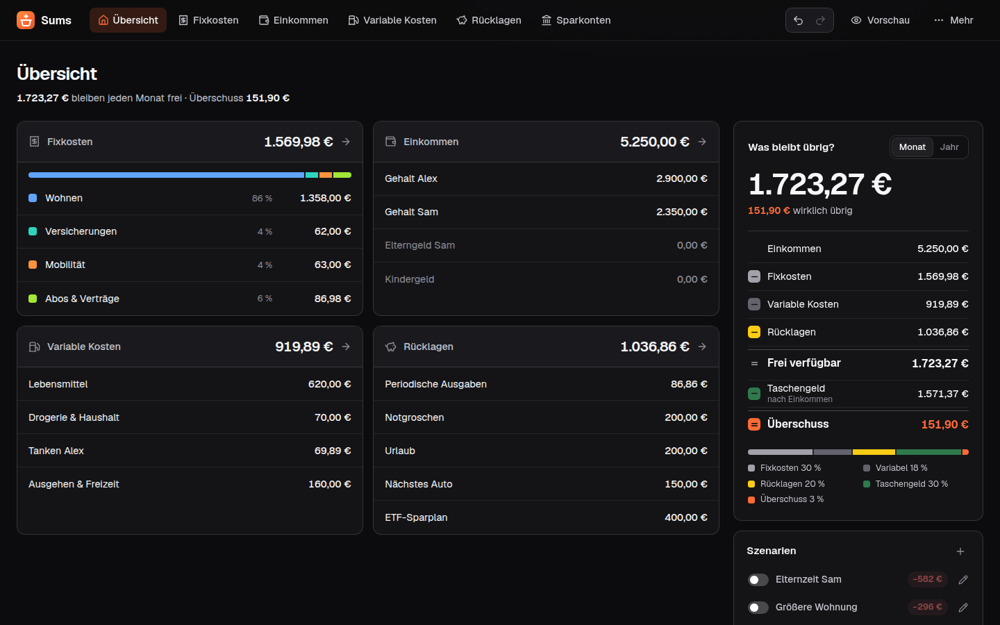
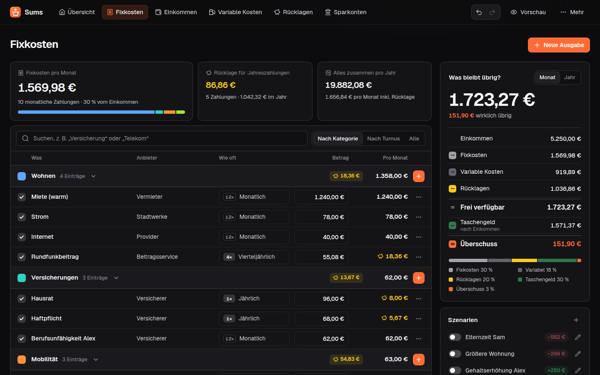
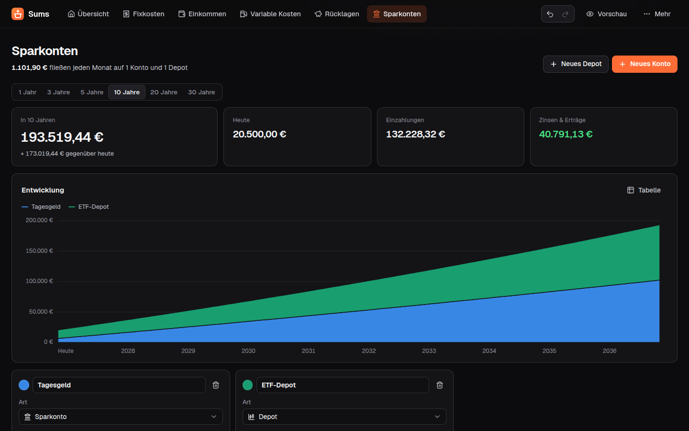

<div align="center">


# Sums

**Plan your household budget and see what is left each month, before it is spent.**

<a href="https://app.sums.keckdev.de/uebersicht?beispiel=1"></a>

[](https://github.com/benediktkeck/sums/actions/workflows/ci.yml) [](https://github.com/benediktkeck/sums/releases) [](LICENSE)

Self-hosted with Docker · No bank connection · No account · German interface

</div>

<br>

<picture>
  <source media="(prefers-color-scheme: light)" srcset="docs/images/overview-light.png">
  
</picture>

## What it does

Sums is a budget **planner**, not a spending tracker. You write down what comes in each month, what goes out and what you put aside, and Sums shows what is left for each of you.

- **Scenarios.** "What if" switches for parental leave, a new job or a bigger flat. Flip one and every number updates, with its impact shown next to it.
- **Fair split.** What is left becomes pocket money per person (equal, by income, or not at all) up to a cap you set. The rest is surplus.
- **Yearly bills handled.** Quarterly and yearly payments are saved for automatically, month by month.
- **Savings accounts and depots** with a growth projection over up to 30 years.
- **Nothing gets lost.** Every change is a version: undo, redo, and go back to any earlier state.
- **Works on your phone** and installs as an app.

<table>
  <tr>
    <td width="50%">
      <picture>
        <source media="(prefers-color-scheme: light)" srcset="docs/images/fixkosten-light.png">
        
      </picture>
    </td>
    <td width="50%">
      <picture>
        <source media="(prefers-color-scheme: light)" srcset="docs/images/sparkonten-light.png">
        
      </picture>
    </td>
  </tr>
  <tr>
    <td align="center">Fixed costs</td>
    <td align="center">Savings projection</td>
  </tr>
</table>

> [!NOTE]
> The interface is German only for now (`de-DE`, amounts in €). All screenshots show a made-up demo plan.
>
> The [hosted version](https://app.sums.keckdev.de) needs no setup: your plan stays in your browser and never reaches the server. To use one plan on several devices, host Sums yourself.

## Self-hosting

You need Docker. Download the compose file, set a password in it, start:

```bash
curl -O https://raw.githubusercontent.com/benediktkeck/sums/main/docker-compose.yml
docker compose up -d
```

Then open `http://<your server>:3000`. Images exist for `linux/amd64` and `linux/arm64` (Raspberry Pi, most NAS boxes).

<details>
<summary>Without Compose</summary>

```bash
docker run -d --name sums --restart unless-stopped \
  -p 3000:3000 -v sums-data:/data -e SUMS_PASSWORD=change-me \
  ghcr.io/benediktkeck/sums:1
```

</details>

**Updating.** `docker compose pull && docker compose up -d`. Database changes are applied on start. The `:1` tag follows all 1.x releases; pin an exact version such as `:1.0.0` to update by hand. Going back to an older version is not supported, so take a backup first.

**Backups.** Download a backup file in the app (*Einstellungen → Daten & Sicherung*), or copy the database while Sums is stopped:

```bash
docker compose stop && docker compose cp sums:/data ./sums-backup && docker compose start
```

**Security.** Set `SUMS_PASSWORD` as soon as anyone but you can reach the port. On the internet, put Sums behind a reverse proxy with HTTPS (Caddy, Traefik, nginx) or keep it inside a VPN. Failed logins are rate-limited per client address; a proxy must set `X-Forwarded-For`.

**Limits.** One plan per installation, one shared password, no user accounts. Sums has to run at the root of a domain or port, not under a sub-path.

### Configuration

All settings are environment variables. Only the password matters for most installations.

| Variable | Default | |
|---|---|---|
| `SUMS_PASSWORD` | none | Shared password for the whole installation. |
| `SUMS_APP_NAME` | `Sums` | Name shown in the app and on the home screen. |
| `SUMS_DB_PATH` | `/data/sums.db` | SQLite database file. |
| `SUMS_SESSION_SECRET` | generated | Key for login cookies. Without it, one is created next to the database on first start. |
| `SUMS_STORAGE` | `server` | `local` keeps each visitor's plan in their own browser and the server stores nothing. For public demo installations. |

<details>
<summary>Settings for public installations</summary>

| Variable | |
|---|---|
| `SUMS_IMPRINT_URL`, `SUMS_PRIVACY_URL` | Links to your legal notice and privacy policy. Without a privacy URL, Sums links its built-in page at `/datenschutz`, which describes what the installation does. |
| `SUMS_HOSTING_PROVIDER` | Hosting provider named on the built-in privacy page. |
| `SUMS_POSTHOG_KEY`, `SUMS_POSTHOG_HOST` | Cookieless usage analytics with PostHog. Off when unset. |

Analytics are off unless you set a key, and an installation never sends anything to the authors. When an operator turns it on, events go through a relay on the same origin, nothing is stored on the device, and events never contain plan content (amounts, names, labels). Visitors can opt out in *Einstellungen → Daten & Sicherung*; browsers sending Do Not Track or Global Privacy Control are never counted. Enable *Cookieless tracking* in the PostHog project, or PostHog discards the events.

</details>

## Development

Requires Node 24 and pnpm.

```bash
pnpm install
pnpm dev        # http://localhost:3000
pnpm test
```

[CONTRIBUTING.md](CONTRIBUTING.md) explains the project layout and the ground rules, [docs/PLAN.md](docs/PLAN.md) the domain model and how everything is calculated.

## Roadmap

- English interface
- A money-flow board that shows where each euro goes
- Contract end dates and reminders, CSV and PDF export

Ideas and bug reports are welcome in the [issues](https://github.com/benediktkeck/sums/issues).

## License

[AGPL-3.0](LICENSE). Use, change and host Sums freely. If you offer a modified version to others over a network, publish your changes under the same license.
